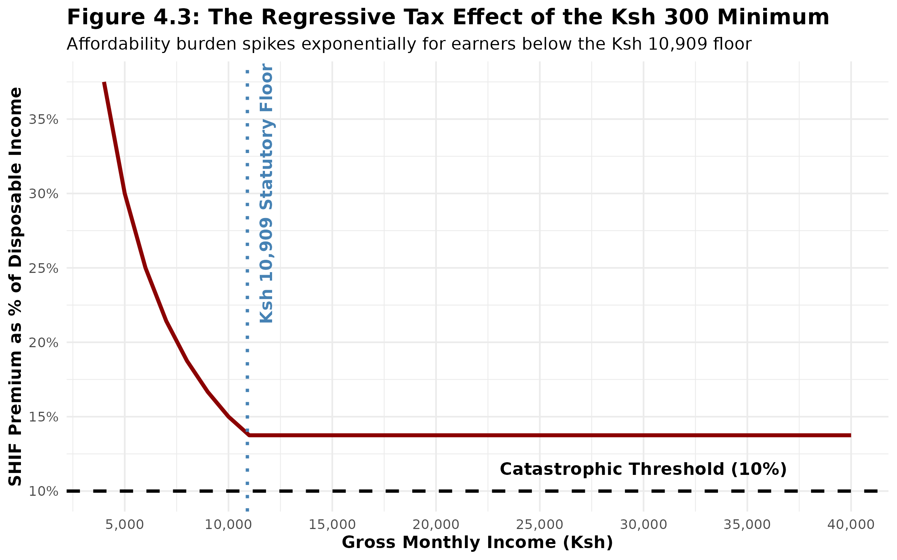
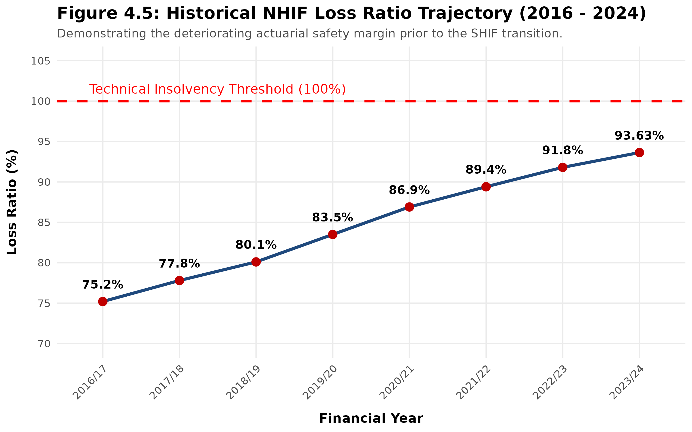
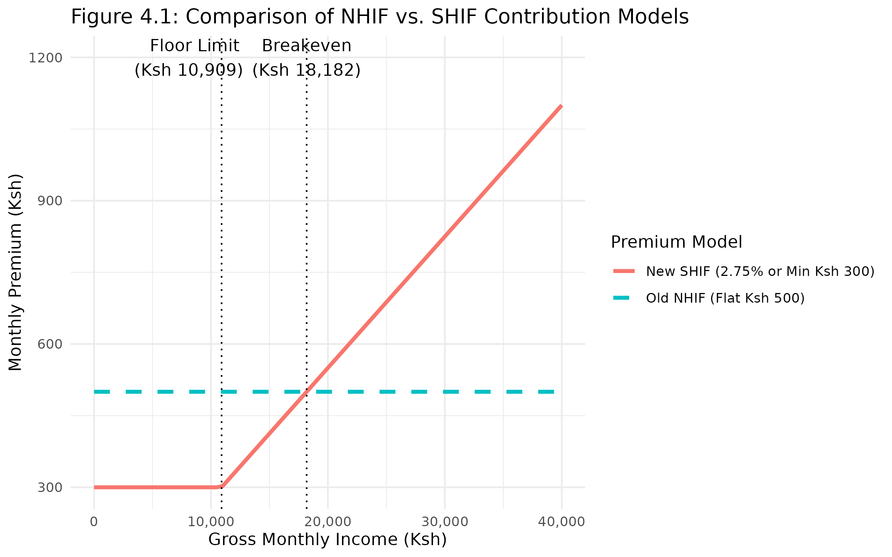
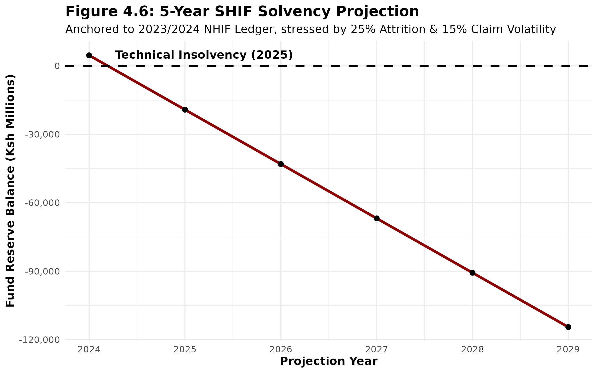

<div align="center">

# 🏥 Actuarial Models in R: Kenya's NHIF → SHIF Transition

### Can Kenya's poorest households actually afford universal health cover?

**The R models behind my actuarial case study of the Social Health Insurance Fund: affordability, default risk and fund solvency.**

[](https://jessywaweru.github.io/SHIF-Coverage-Gaps-Case-Study.pdf.pdf)
[](https://jessywaweru.github.io/FINAL-YR-PRESENTATION/)


-276DC3?logo=r&logoColor=white)


</div>

---

## 🧠 The question

SHIF charges **2.75% of income, with a floor of KES 300 a month**. That sounds progressive, until you do the maths for someone earning KES 5,000 with most of it already spent on food and rent.

These scripts quantify that gap and what it means for the fund's survival.

## 📈 The findings, in pictures

| The regressive floor | NHIF's deteriorating loss ratio |
|:---:|:---:|
|  |  |
| **NHIF vs SHIF contributions** | **Solvency under stress** |
|  |  |

## 🧮 The models

| Script | What it does |
|---|---|
| [`SHIF_Model.R`](SHIF_Model.R) | Simulates a 1,000-household **Homa Bay proxy dataset** (income, seasonality), fits a **logistic regression** of premium default on the affordability ratio, validates it against a null model, and runs **sensitivity scenarios** on fund solvency |
| [`NHIF_time_series.R`](NHIF_time_series.R) | Builds the 2016–2024 **NHIF loss-ratio trajectory** and an **ARIMA forecast** of claims for 2025–2029 |
| [`Affordability_Curve.R`](Affordability_Curve.R) | Plots the **affordability burden** across income bands, showing the spike below the KES 10,909 break-even income |

```r
# The heart of it: what drives a household to stop paying?
glm(Default ~ Ai + Vi + Yi, family = binomial(link = "logit"))
#   Ai = premium / disposable income   Vi = income volatility   Yi = income
```

## 💡 The recommendation

An **Adjusted Progressive Premium Model (APPM)**: tiered pricing, targeted state subsidies (based on Rwanda's Ubudehe model), and microfinance partnerships to cushion seasonal income shocks.

The [interactive deck](https://jessywaweru.github.io/FINAL-YR-PRESENTATION/) lets you drag the sliders yourself 🎚️

## ▶️ Reproduce it

```r
install.packages(c("ggplot2", "dplyr", "scales", "forecast", "gridExtra"))
source("SHIF_Model.R")          # set.seed(2024), so the numbers match exactly
source("NHIF_time_series.R")
source("Affordability_Curve.R")
```

---

<div align="center">

**Built by Jessy Bryan Waweru**: actuary by training, full-stack engineer by obsession.

[](https://www.linkedin.com/in/jessy-waweru-b8051a288)
[](mailto:bryanjessywaweru@gmail.com)
[](https://github.com/JessyWaweru)

</div>
